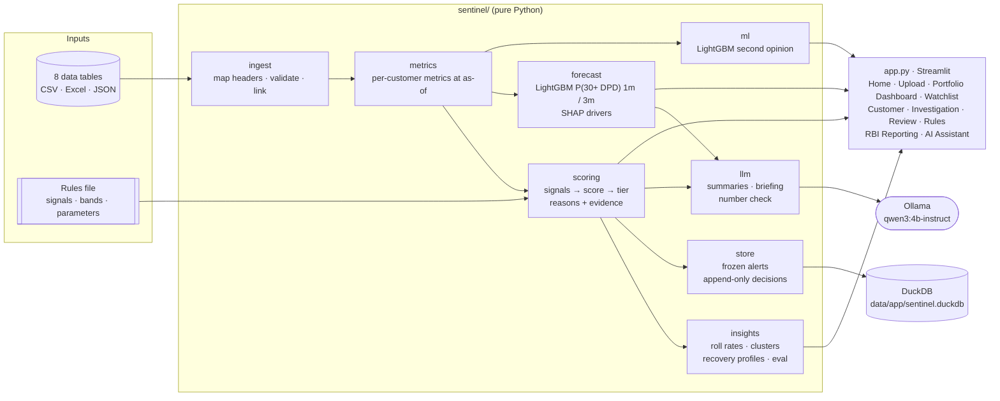

# Sentinel: Early Warning System

**Azentio AI Hackathon · Problem statement 4 (Early Warning System), Level 1.**

Sentinel watches a loan portfolio *after* disbursement and flags customers whose credit is
deteriorating, **before** they become seriously delinquent. It:
- ingests customer, facility, repayment, delinquency, exposure and account data;
- scores every customer 0–100 with configurable, explainable rules;
- forecasts who will reach 30+ days past due next month or quarter;
- gives credit-risk teams a home briefing, watchlist, customer drill-down and an auditable
  review workflow.

Scores are deterministic and explainable. ML forecasts and LLM text are **advisory layers**
on top: they never change a score or tier.

---

## Contents
1. [Quick start](#1-quick-start)
2. [What it does](#2-what-it-does)
3. [Architecture](#3-architecture)
4. [How a customer is scored](#4-how-a-customer-is-scored)
5. [Machine learning](#5-machine-learning)
6. [Local LLM](#6-local-llm)
7. [Data](#7-data)
8. [Results](#8-results)
9. [Level 1 requirements coverage](#9-level-1-requirements-coverage)
10. [Project layout](#10-project-layout)
11. [Documentation](#11-documentation)
12. [Known limitations](#12-known-limitations)

---

## 1. Quick start

Requirements: Python 3.12, [uv](https://docs.astral.sh/uv/). On macOS, LightGBM also needs
the OpenMP runtime.

```bash
brew install libomp            # macOS only, for LightGBM
uv sync                        # install locked dependencies into .venv
uv run streamlit run app.py    # http://localhost:8501
```

The clean sample portfolio (600 customers) loads automatically and the forecast model trains
in about 5 seconds on first load.

**Optional: local LLM** (no API keys, no token cost; the app works fully without it):

```bash
ollama serve
ollama pull qwen3:4b-instruct  # default; llama3.2:3b is the fallback
```

Use the **`-instruct`** tag: plain `qwen3:4b` is a thinking-only build that writes its
reasoning into the answer.

**Clean demo state** (removes published alerts and analyst decisions):

```bash
rm data/app/sentinel.duckdb
```

---

## 2. What it does

| Page | Purpose |
|---|---|
| **Home** | Morning briefing: Red/Amber today, **forecast of new 30+ DPD customers next month and quarter**, exposure at risk, open alerts, an AI-written briefing, and red-flag tabs (likely to hit 30+ DPD, newly escalated, hard triggers, emerging segments, recovering), outlook charts and a model card |
| **Upload & Validate** | Load CSV / Excel / JSON (or the bundled clean/dirty samples); about 21 validation checks; accepted vs rejected rows; relationship coverage; filterable issues list |
| **Portfolio Dashboard** | Tier mix, trajectory, **emerging risk clusters** (segment lift with a Wilson test), **roll-rate matrix**, pre-delinquent vs delinquent split, score movers, intervention workload, priority matrix, accuracy vs planted ground truth |
| **Watchlist** | Filterable list (tier, product, segment, portfolio, DPD bucket, region, trajectory, confidence, SMA category) with score, tier, composite priority, forecast, confidence, contributing indicators, recommended intervention and monitoring/review status; CSV export |
| **Customer** | Score breakdown (points per signal), reasons vs thresholds, module indices, **delinquency forecast with SHAP drivers** and silent-stress warning, ML second opinion, AI summary, history charts, repayment/facility/exposure/evidence tabs |
| **Investigation** | Single-customer workspace: correlated deterioration patterns, recommended interventions by urgency, module indices, 12-month score and indicator history, and a case file for interventions, ownership and analyst notes |
| **Review** | Publish frozen alerts; record append-only analyst decisions (Continue Monitoring · Requires Investigation · False Positive · Escalate for Review) with mandatory reason |
| **Rules** | Edit thresholds, severe levels, weights and bands; instant portfolio re-score with before/after counts; download rules JSON |
| **RBI Reporting** | SMA distribution and mix by portfolio, SMA migration matrix, SMA trend, EWS compliance tiles (TAT, escalation, resolution), SMA-2/NPA detail; Excel and CSV download |
| **AI Assistant** | Chat about a selected customer; answers are grounded in that customer's evidence |

Every element is explained in **[docs/UI_GUIDE.md](docs/UI_GUIDE.md)**.

---

## 3. Architecture



**Design principles**
- **Two-stage compute.** Heavy metrics are computed once per dataset and as-of date
  (~0.4 s, cached). Scoring from metrics plus rules is cheap (~0.5 s) and re-runs on every
  rules edit.
- **Point-in-time.** Every metric uses only data dated on or before the as-of date, so the
  same code scores today, scores 3 months ago (trajectory) and builds ML training data.
- **Missing ≠ zero.** Missing data marks a signal "not evaluated" and lowers confidence; it
  never adds risk.
- **Rules are configuration, not code.** Thresholds, weights and bands live in the rules file.
- **Explain everything.** Each score carries an evidence JSON (every signal's value,
  threshold, strength and points) that is frozen into alerts and sent to the LLM.
- **AI is advisory.** ML and LLM outputs sit beside the rule-based tier, never inside it.

| Layer | Technology |
|---|---|
| UI | Streamlit, Altair |
| Core | pandas, NumPy |
| ML | LightGBM, SHAP, scikit-learn |
| LLM | Ollama (local), qwen3:4b-instruct |
| Storage | DuckDB (alerts, decisions); input data in memory |
| Tooling | uv, Python 3.12 |

Design documents: [docs/data_architecture.md](docs/data_architecture.md) (ER diagrams, DDL
in [sql/schema.sql](sql/schema.sql)) and [docs/app_architecture.md](docs/app_architecture.md)
(design review and trade-offs).

---

## 4. How a customer is scored

```
metrics at as-of date
  → 21 signals: strength 0 below threshold, 0.5 at threshold, 1.0 at "severe" (NaN = not evaluated)
  → raw score = Σ weight × strength
  → mitigation: one isolated, recovered delay = −10 (−15 with verified evidence);
                blocked if cash-flow or exposure stress > 50
  → score = clip(0, 100)            higher = riskier
  → tier from bands
  → hard triggers: DPD ≥ 90 → Red · DPD ≥ 30 or 2+ consecutive missed months → ≥ Amber
  → confidence (data completeness): Low with no hard evidence → capped at Watch
  → trajectory vs 3 months ago · reasons · evidence JSON
```

**Signals and default weights**

| Module | Signals (weight) |
|---|---|
| Repayment (RBDI) | Repeated late/missed months (30) · Worsening DPD (15) · In arrears (15) · Partial payments (10) · Recent cure (8) |
| Cash flow (CFSI) | Sustained inflow decline (20; SMEs year-on-year) · Consecutive declines (8) · Salary stopped (15) · Balance erosion (10) · Returned payments (10) |
| Exposure (LPI) | High utilisation (12) · Utilisation spike (10) · Debt burden ≥ 50% (15) · New credit (12) · Exposure outpacing income (10) |
| Bureau | Delinquency at other lenders (12) · Bureau score drop (6) |
| Mitigant (S4) | Isolated delay with recovery (−10) |
| Data quality (S7) | Short history · Missing months · Bureau no-hit (weight 0: confidence only) |

**Built-in fairness to temporary events:**
- delays within 3 grace days, or across a moon-sighting bank holiday (Eid-ul-Fitr, Bakrid,
  Muharram, Milad-un-Nabi), are excused;
- repayment signals count **months**, not instalments (several facilities ≠ several times the risk);
- seasonal businesses are compared year-on-year.

**Tiers (current bands)**

| Tier | Score | Monitoring status | Recommended action |
|---|---|---|---|
| 🟩 Green | 0–29 | NORMAL | Routine monitoring |
| 🟨 Watch | 30–59 | WATCHLIST | RM review; soft-touch contact |
| 🟧 Amber | 60–79 | ACTION_REQUIRED | Contact customer; assess restructuring or limit freeze |
| 🟥 Red | 80–100 or hard trigger | ESCALATE | Credit committee / collections; review provisioning |

All values are in `data/sample/rules/risk_signal_definitions.json` (generated from
`datagen/rules.py`) and can be edited live on the Rules page. Full definitions:
[docs/IMPLEMENTATION.md §4–5](docs/IMPLEMENTATION.md).

---

## 5. Machine learning

| Model | Question | Training | Where shown |
|---|---|---|---|
| **Delinquency forecast** (`sentinel/forecast.py`) | Will a customer **below 30 DPD today** reach **30+ DPD** within **1 month / 3 months**? | Point-in-time panel: metrics recomputed at 17 past month-ends (~8.8k rows), labelled with actual outcomes; LightGBM; **out-of-time validation** on the last 3 snapshots | Home KPIs, red flags, outlook, model card; Watchlist column; Customer forecast block with SHAP drivers |
| **Second opinion** (`sentinel/ml.py`) | Will the customer be Amber/Red in 3 months (per the rules)? | Metrics 3 months ago → current tier; LightGBM + SHAP | Watchlist column; Customer page |
| **Roll-rate matrix** (`sentinel/insights.py`) | Probability of moving to a worse DPD bucket next month | ~19k facility-month transitions by portfolio | Portfolio heatmap; Customer roll probability; watchlist sorting |

**Forecast back-test (months the model never saw):**

| Horizon | AUC | Top-10% capture | Predicted vs actual events |
|---|---|---|---|
| Next month | 0.96 | 90% | 12 vs 21 |
| Next quarter | 0.89 | 67% | 40 vs 54 |

The forecast ranks customers well but under-predicts totals (recent months had more new
delinquencies than training months), so expected counts are shown as a floor. A Green or
Watch customer with ≥ 20% three-month probability gets a **silent stress** flag.

---

## 6. Local LLM

All generation runs **locally through Ollama**: no API keys, no per-token cost, and no data
leaves the machine.

| Feature | Page | Input → output |
|---|---|---|
| Customer risk summary | Customer | ~270 tokens of facts (tier, score, top reasons, mitigation, trigger, policy action) → 3–5 sentences + suggested action |
| Portfolio risk briefing | Home | Dashboard facts (KPIs, top forecast customers and drivers, escalations, triggers, segments) → 4–6 bullets + "Focus today" |
| AI Assistant chat | AI Assistant | Selected customer's evidence + question → grounded answer |

**Guardrails**
- **Number check:** every number above 12 in the output must appear in the facts sent;
  otherwise a warning is shown and a deterministic template is used instead.
- **Wording:** the system prompts forbid invented numbers, names or causes, and require
  forecasts to be called "30+ DPD" probabilities, not default probabilities.
- **Settings:** temperature 0.1, capped output length, results cached per customer or
  dataset + rules version + model.
- **The LLM never computes or changes a score, tier or decision.**

**Model choice** (`scripts/llm_bakeoff.py`, 20 customers across all tiers, Apple M5 Pro):

| Model | Number check passed | Median latency | Tokens in / out |
|---|---|---|---|
| **qwen3:4b-instruct** (default) | 100% | 1.4 s | ~268 / ~107 |
| llama3.2:3b (fallback) | 100% | 1.0 s | ~272 / ~94 |
| llama3.1:8b | 100% | 2.5 s | ~262 / ~102 |

---

## 7. Data

Two fully **synthetic** Indian bank portfolios (INR); no real customers or PII. Both appear in
the **Upload & Validate → Bundled dataset** dropdown (each with a *dirty* variant for testing
validation) and are processed entirely on the local machine (load + score + forecast < 10 s).

| Dataset | Profile | Customers | NPL (90+ DPD, by value) | Planted clusters |
|---|---|---|---|---|
| **Synthetic Bharat Commercial Bank** (`data/sample`) | Diversified, retail-led, Mumbai/Delhi NCR/Bengaluru | 600 (30% SME) | 0.1% (early-warning focus, no legacy defaults) | Construction MSMEs Delhi NCR/Pune; hospitality staff Bengaluru |
| **Northern Plains Commercial Bank** (`data/northern_sme`) | MSME-heavy mid-market lender in Ludhiana / Jalandhar / Kanpur, stressed 2026 | 1,200 (45% SME) | 12.8% (retail secured 1.7%, retail unsecured 4.9%, MSME 13.3%) with a legacy NPL stock in collections | Hauliers Ludhiana/Kanpur (freight and diesel costs); retail-trade staff Ludhiana/Jalandhar (pay cuts); restaurants Agra/Meerut (weak monsoon season) |

The tables below describe the Bharat Commercial Bank sample; the Northern dataset uses the same schema at about twice the volume.

| Table | Rows | Grain |
|---|---|---|
| customers | 600 | customer (420 individuals, 180 MSMEs) |
| facilities | 1,069 | loan / card / cash-credit line (7 products) |
| repayments | 19,414 | instalment due (FIFO payment allocation) |
| delinquency | 19,669 | facility × month-end |
| exposure | 13,617 | customer × month-end (on-us + credit bureau) |
| financials | 13,575 | customer × month (salary, receipts, balances, bounced payments) |
| exception_evidence | 71 | documented reasons for irregular payments (verified Y/N) |
| bank_holidays | 22 | published and moon-sighting holidays |

- **History:** 24 months, Oct 2024 to Sep 2026; as-of date **2026-09-30**.
- **Behaviour:** 16 planted behaviour archetypes covering all 8 challenge scenarios, plus 2
  emerging risk clusters (construction MSMEs in Delhi NCR/Pune; hospitality employees in
  Bengaluru).
- **Calibration:** urban salaried borrowers — median declared income about ₹53,650 a month;
  segments are Mass (< ₹40k), Mass Affluent (₹40k–₹1L) and Affluent (≥ ₹1L). MSME monthly
  receipts annualise inside the MSME turnover definitions (micro ≤ ₹5 cr, small ≤ ₹50 cr,
  medium ≤ ₹250 cr); median SME turnover is about ₹3.2 cr. The book is about ₹236 Cr.
- **Traps:** seasonal MSMEs, moon-sighting-holiday delays, unverified excuses, off-us
  delinquency leading on-us, salary credited elsewhere, data-feed gaps.
- **`data/sample/`:** clean set in CSV and Excel (JSON is regenerable) plus the rules file.
- **`data/dirty/`:** the same data with 72 logged defects for validation testing.
- **`data/_ground_truth/`:** planted archetype and band per customer, for evaluation only.

```bash
uv run python datagen/generate.py   # regenerate (deterministic, seed 42)
uv run python datagen/generate.py --profile northern_sme --out data/northern_sme
uv run python datagen/checks.py     # 41 consistency checks
```

Data dictionary: [data/README.md](data/README.md).

---

## 8. Results

On the clean sample with the current rules:

| Measure | Result |
|---|---|
| Records ingested (CSV, Excel or JSON) | 68,037, 0 issues |
| Dirty sample | 641 rows rejected, 42 warnings; all 15 injected defect types caught |
| Tier distribution | 452 Green · 55 Watch · 53 Amber · 40 Red |
| Planted High/Critical rated Amber or Red | 59.7% |
| Planted low-risk rated Amber or Red (false alarms) | 0.2% |
| Within one tier of planted band | 96.8% |
| Trap customers flagged Amber/Red | 1 / 153 |
| Top emerging cluster | Construction & Contracting · Pune (planted) |
| Forecast AUC (out-of-time) | 0.96 next month · 0.90 next quarter |
| Scoring time (600 customers) | ~0.5 s per re-score |

---

## 9. Level 1 requirements coverage

| Required capability | Status |
|---|---|
| 1. Data ingestion: CSV/Excel/JSON, validation, relationships | ✅ for the 8 data tables. ⚠️ The **risk signal definitions file can't be uploaded through the UI yet** (bundled file, live editing and download only) |
| 2. Signal detection: repeated delays, temporary misses, declining cash flow, increasing exposure, missing history, changes over time | ✅ |
| 3. Warning score: scale, direction, contributing factors, explanation | ✅ |
| 4. Watchlist: required columns, five filters, drill-down | ✅ |
| 5. Review: four decisions, reason, original score and evidence preserved | ✅ |

---

## 10. Project layout

```
app.py                       Streamlit UI (9 pages)
sentinel/
  ingest.py                  file reading, header aliases, validation, cross-table checks
  metrics.py                 point-in-time customer metrics
  scoring.py                 signals, mitigation, triggers, confidence, tiers, evidence
  insights.py                roll rates, clusters, recovery profiles, ground-truth eval
  forecast.py                30+ DPD forecast (1m/3m), out-of-time validation, SHAP drivers
  ml.py                      LightGBM second opinion + SHAP
  llm.py                     Ollama client, prompts, number check, templates
  store.py                   DuckDB alerts and decisions
datagen/                     synthetic data generator, rules source, dirty variant, checks
scripts/llm_bakeoff.py       compare local LLMs on grounding, latency and tokens
data/                        Bharat Commercial Bank sample/dirty/ground truth/rules; data/northern_sme/ second portfolio
docs/                        architecture, implementation and UI guides
sql/schema.sql               DuckDB DDL for inputs and outputs
FINAL_ARCHITECTURE.md        team architecture document
PLAN_AND_ARCHITECTURE.md     team plan
ews_final_features.txt       original Sentinel feature specification
models.ipynb                 model exploration notebook
```

---

## 11. Documentation

| Document | Contents |
|---|---|
| [docs/IMPLEMENTATION.md](docs/IMPLEMENTATION.md) | Module-by-module implementation: validation checks, metric definitions, signal table, scoring pipeline, forecast, LLM, configuration, results |
| [docs/UI_GUIDE.md](docs/UI_GUIDE.md) | Every page, control, chart and column; demo walkthrough; glossary |
| [docs/data_architecture.md](docs/data_architecture.md) | Data flow, ER diagrams, module-to-table mapping, schema gaps |
| [docs/app_architecture.md](docs/app_architecture.md) | Design review of the Sentinel spec, recommended architecture, trade-offs |
| [docs/prototype_1h_plan.md](docs/prototype_1h_plan.md) | Timeboxed prototype plan, trade-offs and build results |
| [data/README.md](data/README.md) | Synthetic data dictionary, archetypes and traps |
| [FINAL_ARCHITECTURE.md](FINAL_ARCHITECTURE.md) | Team architecture (Investigation, RBI Reporting, AI Assistant, ML) |

---

## 12. Known limitations

- **Organiser schemas:** only header aliases are supported; there's no column-mapping screen.
  Unfamiliar layouts may fail validation.
- **Rules upload:** not yet possible through the UI (see §9).
- **Forecast totals** are under-predicted in back-testing; use rankings first.
- **Score bands:** the current 30/60/80 bands catch fewer planted high-risk customers than
  the earlier 25/45/70.
- **Point-in-time history** for past dates approximates partial payments.
- **Operations:** single user, no authentication; the app database is local; no automated
  test suite (data checks and the accuracy panel only).
