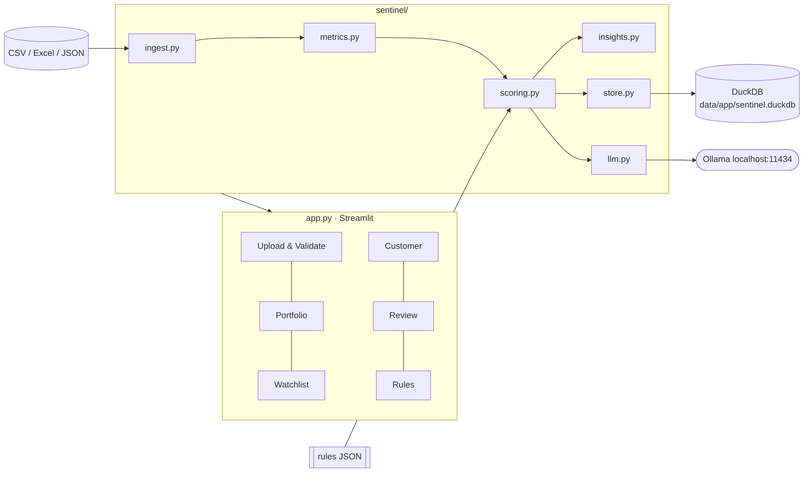

# Sentinel EWS: implementation guide

How the current prototype works, module by module. This describes **what is built** on
branch `haren-dev`. For the design rationale and alternatives see
[app_architecture.md](app_architecture.md); for the input data model see
[data_architecture.md](data_architecture.md).

- **Status:** working prototype. All 5 Level 1 capabilities implemented and verified in the browser.
- **Stack:** Python 3.12 · pandas · Streamlit · DuckDB · Altair · Ollama (local LLM, optional).
- **Size:** about 1,560 lines of app/library code plus 1,900 lines of data generator.

---

## 1. Running it

```bash
uv sync                                   # install locked dependencies
uv run streamlit run app.py               # http://localhost:8501
```

Optional AI summaries (local, no API keys, no token cost):

```bash
ollama serve
ollama pull qwen3:4b-instruct             # default model; llama3.2:3b is the fallback
```

Other commands:

| Command | Purpose |
|---|---|
| `uv run python datagen/generate.py [--customers N --seed S]` | Regenerate the synthetic dataset (deterministic) |
| `uv run python datagen/checks.py [folder]` | 41 consistency checks on a CSV folder |
| `uv run python scripts/llm_bakeoff.py qwen3:4b-instruct llama3.2:3b` | Compare local models on the same customers |
| `rm data/app/sentinel.duckdb` | Reset alerts and analyst decisions (clean demo state) |

---

## 2. Architecture



**Two-stage compute.** Scoring is split so that rules edits are instant:

| Stage | Function | Cost (600 customers) | Cached on |
|---|---|---|---|
| 1. Metrics | `metrics.compute(tables, as_of, params)` | ~0.4 s | dataset + as-of date + parameters |
| 2. Score | `scoring.score(metrics, rules, customers)` | ~0.5 s | not cached; re-runs on every rules change |

Both stages are pure functions of their inputs. The app runs them twice: at the as-of date,
and at as-of minus 3 months for the trajectory.

### Module map

| File | Lines | Responsibility |
|---|---|---|
| `app.py` | 523 | Streamlit UI: 6 pages, session state, caching, charts |
| `sentinel/ingest.py` | 312 | File reading, header mapping, validation, relationship checks |
| `sentinel/metrics.py` | 257 | Per-customer metrics at an as-of date |
| `sentinel/scoring.py` | 155 | Signals → points → mitigation → triggers → confidence → tier, reasons, evidence |
| `sentinel/forecast.py` | ~150 | Point-in-time LightGBM forecast of 30+ DPD in 1/3 months, out-of-time validation, SHAP drivers |
| `sentinel/insights.py` | 116 | Roll-rate matrix, cluster detection, ground-truth evaluation |
| `sentinel/store.py` | 80 | DuckDB persistence for alerts and decisions |
| `sentinel/llm.py` | 112 | Ollama client, prompt, grounding check, template fallback |
| `scripts/llm_bakeoff.py` | 52 | Model comparison harness |
| `datagen/*` | 1,910 | Synthetic data generator, rules file, dirty variant, checks |

---

## 3. Ingest and validation (`sentinel/ingest.py`)

### Reading files
- **Formats:** `.csv`, `.xlsx` (every sheet), `.json` (an array of records, or an object keyed by table name).
- **Table detection** comes from the file or sheet name, using exact names or hints:
  `customer`, `facilit`/`loan`, `repay`, `delinq`/`dpd`, `exposure`, `financ`/`transaction`,
  `evidence`/`exception`, `holiday`/`calendar`.
- **Header mapping:** headers are lower-cased and snake-cased, then common variants are
  mapped to canonical names (`cust_id`/`cif`/`client_id` → `customer_id`,
  `loan_id`/`account_id` → `facility_id`, `dpd` → `days_past_due`, `due_amount` →
  `amount_due`, `paid_date` → `payment_date`, `emi` → `instalment_amount`, `limit` →
  `sanctioned_amount`, and others).
- Everything is read as text first, then coerced, so malformed values are caught rather than silently converted.

### Checks
Rows with an **ERROR** are rejected. Rows with a **WARNING** are normalised and kept.

| Check | Severity | Behaviour |
|---|---|---|
| Missing table | ERROR (WARNING for evidence) | Reported |
| Missing required column | ERROR | Table skipped |
| Blank mandatory field | ERROR | Row rejected |
| Enum wrong case / whitespace (e.g. `" individual"`) | WARNING | Upper-cased and kept |
| Unknown enum value | ERROR | Row rejected |
| Non-ISO date (e.g. `05/03/2026`) | WARNING | Parsed day-first |
| Unparseable date in a required column | ERROR | Row rejected |
| Text in a numeric column (e.g. `"INR 12,500.00"`) | WARNING | Stripped to a number |
| Negative amount / DPD | ERROR | Row rejected |
| Duplicate primary key | WARNING | First occurrence kept, duplicates dropped |
| Orphan reference (unknown customer or facility) | ERROR | Row rejected |
| Repayment customer ≠ facility owner | WARNING | Facility owner used |
| Payment before disbursement | ERROR | Row rejected |
| Non-INR currency | WARNING | Kept, flagged |
| `CLOSED` facility with balance | WARNING | Kept, flagged |
| `PAID_ON_TIME` but paid after due date | WARNING | Dates take precedence |
| Amount paid > 3× due | WARNING | Kept, flagged |
| DPD > 0 with zero overdue | WARNING | Kept, flagged |
| Bureau score outside 300–900 | WARNING | Value nulled |
| Negative utilisation | WARNING | Kept, flagged |
| `net_cash_flow` ≠ inflows − outflows | WARNING | Recomputed |

`validate()` returns `(clean_tables, issues, summary)`. Each issue carries table, record
key, column, type, severity and message.

**Note on cascades:** rejecting a customer (e.g. one with a blank `customer_type`) also
orphans that customer's facilities and repayments. This is why the dirty set reports ~486
orphan rows from only 3 injected orphan facilities and 2 blank customer types.

---

## 4. Metrics (`sentinel/metrics.py`)

One row per customer, computed **as of** a date: only records dated on or before it are
used. Column names match the `metric` field in the rules file. **NaN means not evaluable**
(no data); it is never treated as zero.

### Repayment (last 12 months of instalments due before as-of)
- An instalment is **settled** if paid in full by as-of. `late_days` is the payment date
  minus the due date (or as-of minus the due date if unpaid).
- **Excused** if late by no more than `grace_days` (3), or by no more than 5 days with a
  **moon-sighting** bank holiday between the due date and the payment date.
- **Pending** (not irregular yet) if unpaid but due within the grace period.
- **Irregular** = not on time, not excused, not pending.
- Counted **per month, not per instalment**, so a customer with 3 facilities isn't triple-counted.

| Metric | Definition |
|---|---|
| `late_or_missed_instalments` | Months with any irregular instalment, last 6 months |
| `partial_payments` | Months with a partially paid instalment, last 6 months |
| `isolated_delay_recovered` | 1 if exactly one irregular month in 12, at least 6 regular months, and nothing outstanding now |
| `_evidence_verified` | A verified `exception_evidence` record within ±45 days of the irregular instalment |

### Delinquency (month-end snapshots, customer = max across facilities)
| Metric | Definition |
|---|---|
| `current_dpd` | Max DPD at the latest snapshot on or before as-of |
| `dpd_increase_month_ends` | Consecutive month-ends (up to 3) with rising DPD |
| `months_since_cure` | Months since DPD last went from >0 to 0 (NaN if never delinquent or still delinquent) |

### Cash flow (monthly financials)
The income series depends on the customer:
- **SME:** `business_receipts`
- **Individual with salary at this bank:** `salary_credit`
- **Otherwise:** not evaluated

| Metric | Definition |
|---|---|
| `inflow_change_3m_vs_prior_3m_pct` | Individuals: last 3 months avg vs the 3 before. **SMEs: last 3 months vs the same 3 months a year earlier** (removes seasonality). Needs 2+ months in each window |
| `consecutive_inflow_declines` | Consecutive months with a >2% drop (SMEs: on the year-on-year ratio). Needs 4+ months |
| `months_without_salary` | Months of zero/missing salary in the last 3 (salary-at-bank customers only) |
| `avg_balance_change_pct` | Average balance, last 3 vs prior 3 months |
| `returned_payments` | Bounced cheques / failed debits, last 3 months |

### Exposure (monthly snapshots: latest, −3 and −6 months)
| Metric | Definition |
|---|---|
| `revolving_utilisation_pct` | On-us card / WC balance ÷ limit (latest) |
| `utilisation_change_pp` | Latest minus 6 months ago |
| `debt_burden_ratio_pct` | (On-us + bureau monthly obligations) ÷ income. Income is the recent salary if visible, otherwise declared income; zero salary gives 999. **Individuals only** |
| `new_facilities_or_enquiries` | New on-us facilities (two 3-month windows) + growth in bureau facility count + bureau enquiries (two windows) |
| `exposure_growth_minus_income_growth_pp` | % growth in total outstanding (on-us + bureau) over 6 months minus income growth |
| `bureau_external_max_dpd` | Max DPD at other lenders |
| `bureau_score_change` | Bureau score change over 6 months |
| `bureau_no_hit` | 1 if there is no bureau record |

### Completeness
| Metric | Definition |
|---|---|
| `months_of_history` | Months since `customer_since` |
| `missing_financial_months` | Expected months (last 12, or since onboarding) minus months present |
| `data_completeness_score` (DCS) | `100 × (0.35·min(history/12,1) + 0.30·coverage + 0.15·bureau_hit + 0.20·income_visible)` |

Private columns starting with `_` (series for charts, outstanding balance, DBR income) feed the UI but not scoring.

---

## 5. Scoring (`sentinel/scoring.py`)

### 5.1 Signal strength
Each enabled signal maps its metric value to a strength in [0, 1] using **absolute anchors**
from the rules file. Scores are not relative to the rest of the portfolio.

```
not crossing threshold        → 0
at threshold                  → 0.5
at or beyond `severe`         → 1.0      (linear in between)
metric is NaN                 → NaN      ("not evaluated", earns no points)
operator "=="                 → 1 if equal else 0
RS03 (current DPD) special    → 1–30: 0.5 · 31–60: 0.75 · 61+: 1.0
```

`points = weight × strength`.

### 5.2 Signals (current defaults)

| ID | Signal | Module | Scenario | Threshold | Severe | Weight |
|---|---|---|---|---|---|---|
| RS01 | Repeated late or missed instalments | REPAYMENT | S1 | ≥ 2 | 3 | 30 |
| RS02 | Worsening days past due | REPAYMENT | S5 | ≥ 2 | 3 | 15 |
| RS03 | Currently in arrears | REPAYMENT | S5 | ≥ 1 | 60 | 15 |
| RS04 | Partial payments | REPAYMENT | S1 | ≥ 2 | 4 | 10 |
| RS05 | Isolated delay with recovery | MITIGANT | S4 | = 1 | 1 | −10 |
| RS06 | Recent cure | REPAYMENT | S5 | ≤ 3 | 1 | 8 |
| RS07 | Sustained inflow decline | CASH_FLOW | S2 | ≤ −20% | −45% | 20 |
| RS08 | Consecutive monthly inflow declines | CASH_FLOW | S2 | ≥ 3 | 5 | 8 |
| RS09 | Salary stopped | CASH_FLOW | S2 | ≥ 2 | 3 | 15 |
| RS10 | Balance erosion | CASH_FLOW | S6 | ≤ −40% | −70% | 10 |
| RS11 | Returned payments / bounced cheques | CASH_FLOW | S6 | ≥ 2 | 5 | 10 |
| RS12 | High revolving utilisation | EXPOSURE | S3 | ≥ 85% | 100% | 12 |
| RS13 | Utilisation spike | EXPOSURE | S3 | ≥ 25 pp | 50 pp | 10 |
| RS14 | Debt burden above limit | EXPOSURE | S3 | ≥ 50% | 70% | 15 |
| RS15 | New credit accumulation | EXPOSURE | S3 | ≥ 3 | 6 | 12 |
| RS16 | Exposure growing faster than income | EXPOSURE | S3 | ≥ 25 pp | 60 pp | 10 |
| RS17 | Delinquency at other lenders | BUREAU | S1 | ≥ 30 | 90 | 12 |
| RS18 | Bureau score drop | BUREAU | S1 | ≤ −50 | −120 | 6 |
| DQ01 | Insufficient history | DATA_QUALITY | S7 | < 6 months | — | 0 |
| DQ02 | Missing financial months | DATA_QUALITY | S7 | ≥ 1 | 3 | 0 |
| DQ03 | Bureau no-hit | DATA_QUALITY | S7 | = 1 | — | 0 |

Data-quality signals have weight 0. They are reported, but confidence comes from the DCS (§4).

### 5.3 Pipeline (per customer, in order)

1. **Raw score** = sum of points from positive-weight signals.
2. **Module indices**: for each category, points earned ÷ points available among *evaluated* signals × 100:
   - REPAYMENT → **RBDI**
   - CASH_FLOW → **CFSI**
   - EXPOSURE → **LPI**
   - BUREAU → **BUREAU**
3. **Mitigation (S4)**: RS05 points, multiplied by 1.5 when verified evidence exists.
   **Blocked** if CFSI > 50 or LPI > 50 (underlying stress).
4. **Risk score** = clip(raw + mitigation, 0, 100), rounded.
5. **Tier** from the score bands: Green 0–24 · Watch 25–44 · Amber 45–69 · Red 70–100.
6. **Hard triggers**: DPD ≥ 90 → Red; DPD ≥ 30 → at least Amber.
7. **Confidence**: DCS ≥ 75 High · ≥ 40 Medium · otherwise Low.
   **Low confidence with no hard evidence** (DPD = 0 and RS01 not fired) → tier **capped at
   Watch** and marked `insufficient_evidence`. Missing data never escalates a customer.
8. **Monitoring status and recommended action** come from the band.
9. **Reasons**: fired signals sorted by absolute points, formatted as
   `"<name>: <value><unit> (threshold <op> <threshold><unit>)"`.
10. **Evidence JSON**: every signal (value, threshold, strength, points), raw score,
    mitigation, blocked flag, trigger, score, tier, confidence, DCS, DPD and indices. This
    is what gets frozen into alerts and sent to the LLM.

### 5.4 Trajectory
Compare the score now with the score at as-of − 3 months (same rules):
- **New:** no previous score
- **Recovering:** was Amber or Red, now Green or Watch
- **Deteriorating:** up 10 or more points
- **Improving:** down 10 or more points
- **Stable:** otherwise

---

## 6. Portfolio insights (`sentinel/insights.py`)

### Roll-rate matrix (S5)
- **Buckets:** Current · 1-30 · 31-60 · 61-90 · 91-180 · 180+.
- **Transitions:** every facility's month-to-month bucket change, about 19k transitions.
  Normalised by row to give the probability of each next-month bucket.
- **`p_roll`:** probability of moving to a *worse* bucket, per portfolio (Retail Secured,
  Retail Unsecured, MSME Lending) × bucket.
- **Customer roll probability:** the highest `p_roll` across the customer's facilities, given their current buckets.
- **Exposure at risk** = outstanding × roll probability. It's used to sort the watchlist.

### Emerging clusters (S8)
- **Segments:** `category × region`, `primary_product × region`, `category`, and `segment × portfolio`.
- **At risk** = tier Amber or Red. Each segment's at-risk rate is compared with the portfolio rate.
- **Emerging** = at least 3 at-risk customers **and** the Wilson 95% lower bound of the
  segment rate is above the portfolio rate. Segments need at least 5 customers.
- **Momentum** = change in at-risk share vs 3 months ago (pp). Also reported: lift and exposure at risk.

### Evaluation
- Joins scores to `data/_ground_truth/customer_labels.csv`, mapping planted bands
  Low/Medium/High/Critical → Green/Watch/Amber/Red.
- **Reports:** confusion matrix, catch rate (planted High/Critical rated Amber or Red),
  false-alarm rate (planted Low rated Amber or Red), exact and within-one-tier agreement,
  trap customers flagged, and tiers by archetype.
- Shown only for the clean sample.

---

### Delinquency forecast (`sentinel/forecast.py`)
Predicts a **real future outcome**: will a customer currently **below 30 DPD** reach
**30+ DPD within 1 month / 3 months**? This differs from `ml.py` (Pranav's second-opinion
model), which predicts the rule tier.

| Step | Detail |
|---|---|
| Panel | For every past month-end from month 6 onwards (17 snapshots), recompute all metrics **as they stood then** (`metrics.compute(t, d)`), keep customers below 30 DPD at `d`, and label each row with whether the customer's max DPD reached 30 in the next 1 / 3 months. About 8.8k rows. Exception evidence is also filtered to what was recorded by `d` |
| Features | The 20 behavioural metrics from `ml.FEATURE_COLS` + `is_sme` |
| Model | LightGBM (300 trees, depth 4, learning rate 0.03, min 40 rows/leaf), one per horizon |
| Validation | Out-of-time: last 3 labelled snapshots held out, then refit on all rows for scoring |
| Output | `p_1m`, `p_3m` per customer (NaN if already 30+ DPD), top-3 SHAP drivers, monthly history of new 30+ DPD customers |
| Cost | ~1.5 s panel + ~3.5 s training, cached per dataset (`st.cache_resource`) |

**Back-test (sample data):**

| Horizon | AUC | PR-AUC | Top-10% capture | Predicted vs actual events |
|---|---|---|---|---|
| Next month | 0.959 | 0.229 | 90.5% | 12 vs 21 |
| Next quarter | 0.887 | 0.427 | 66.7% | 40 vs 54 |

The model ranks well but **under-predicts totals**, because recent months had more new
delinquencies than training months. Use rankings first and treat expected counts as a floor.

**Red-flag rule:** below 30 DPD and P(30+ DPD in 3m) ≥ 20% (`FORECAST_FLAG` in `app.py`).

## 7. Alerts and review (`sentinel/store.py`)

DuckDB file: `data/app/sentinel.duckdb` (git-ignored).

| Table | Semantics |
|---|---|
| `alerts` | One row per Watch/Amber/Red customer per **run** (`run_id = <as_of>-<rules hash>`). Stores `original_score`, `original_tier`, `confidence`, `reasons_json`, `evidence_json`. **Never updated.** |
| `analyst_decisions` | Append-only: `decision` (CONTINUE_MONITORING · REQUIRES_INVESTIGATION · FALSE_POSITIVE · ESCALATE_FOR_REVIEW), mandatory `reason`, `analyst_id`, timestamp |

- Publishing the same run twice doesn't duplicate alerts.
- An alert's current status is its latest decision; reclassifying adds a row.
- The Review page shows the frozen alert next to the **live** score under current rules, and says when they differ.

---

## 8. Local LLM (`sentinel/llm.py`)

- **Runtime:** Ollama on `OLLAMA_HOST` (default `http://localhost:11434`). If Ollama is
  unreachable, the app uses the deterministic `template_summary`.
- **Model preference:** `qwen3:4b-instruct` → `llama3.2:3b` → `qwen3:8b` → `llama3.1:8b` →
  any installed model. Avoid plain `qwen3:4b`: it's a thinking-only build that writes its
  reasoning into the answer.
- **Input:** compact facts only, about 270 tokens: tier, score, confidence, DPD, the top 5
  reason strings, mitigation note, trigger, data note, and the policy action for the tier.
  The system prompt fixes the tier scale and forbids invented numbers, dates and causes.
- **Generation:** temperature 0.1, max 300 output tokens, `think: false`.
- **Grounding check:** every number above 12 in the output must match a number in the facts
  sent (sign-insensitive, within 1% or 0.6). Otherwise the UI shows a warning and the template summary.
- **Caching:** per customer + rules version + model in the Streamlit session; the caption shows tokens and latency.
- **The LLM never computes or changes a score, tier or decision.**

**Portfolio briefing (Home page):** `llm.briefing(facts, model)` sends the dashboard
facts (KPI counts, top 5 forecast customers with drivers, escalations, hard triggers,
emerging segments). The system prompt forbids invented numbers and requires calling
forecasts "30+ DPD" probabilities, not default probabilities. The same grounding check
applies, with `template_briefing` as the fallback. Typical cost: ~1,300 tokens in / ~330 out,
~5 s.

**Bake-off** (20 customers across all tiers, Apple M5 Pro):

| Model | Grounded | Median latency | Tokens in / out |
|---|---|---|---|
| **qwen3:4b-instruct** (default) | 100% | 1.4 s | ~268 / ~107 |
| llama3.2:3b | 100% | 1.0 s | ~272 / ~94 |
| llama3.1:8b | 100% | 2.5 s | ~262 / ~102 |

---

## 9. User interface (`app.py`)

Element-by-element reference: [UI_GUIDE.md](UI_GUIDE.md).

The sidebar shows the dataset, as-of date, rules version hash and LLM status.

| Page | Features |
|---|---|
| **Upload & Validate** | Bundled clean or dirty dataset, or upload of multiple files. KPIs (received, accepted, rejected, warnings), per-table summary, relationship coverage, issues table filterable by severity, table and type, plus an issue-type chart |
| **Portfolio** | Tier KPIs and outstanding at Amber/Red; tier mix by portfolio; trajectory distribution; emerging-clusters table; roll-rate heatmap; accuracy panel (clean sample only) |
| **Watchlist** | Filters: tier, product, segment, portfolio, delinquency bucket, region, trajectory, confidence, SMA category. Columns: ID, name, products, outstanding, score bar, tier, confidence, trajectory, contributing indicators, DPD bucket, monitoring status, review status. Sorted by tier → score → exposure at risk. Row select → **Open customer**. CSV download |
| **Customer** | Tier badge, score with change vs 3 months, confidence/DCS, trajectory, DPD, roll probability, outstanding; insufficient-evidence and hard-trigger banners; recommended action; points chart; score arithmetic; reasons; all-signals table (fired / ok / not evaluated); module indices; **AI summary**; charts for DPD, income/inflows/balance, utilisation, and on-us vs bureau obligations; tabs for repayments, facilities, exposure and evidence |
| **Review** | Publish alerts for the current run; alert list filterable by status; frozen original vs live score; decision form (4 options, mandatory reason and analyst); append-only history |
| **Rules** | Editable signal table (enabled, threshold, severe, weight) and score bands; **Apply and re-score**, with before/after tier counts; reset to defaults; download rules JSON |

### Caching and state
- `load_folder` and `get_metrics` are cached with `st.cache_data`, keyed by dataset and as-of date.
- Rules live in session state. Editing them changes the rules hash, which flows into the
  run ID and the summary cache keys.

---

## 10. Configuration

`data/sample/rules/risk_signal_definitions.json` (generated from `datagen/rules.py`):

| Section | Contents |
|---|---|
| `parameters` | `as_of_date` 2026-09-30, `grace_days` 3, `excuse_lunar_holiday_delays` true, `trajectory_lookback_months` 3, currency INR, score direction |
| `signals` | The table in §5.2, plus `enabled`, `lookback_months` and `description` |
| `score_bands` | Band, min/max score, monitoring status, recommended action |
| `overrides` | Documented hard triggers and the confidence cap (implemented in `scoring.py`) |

To change defaults permanently, edit `datagen/rules.py` and run `datagen/generate.py`. The
data is deterministic, so only the rules files change. For session-only experiments, use the
Rules page.

`min_history_months`, `min_repayment_records` and `stale_data_months` are in the file but
**not yet used** by the engine.

---

## 11. Verified results (clean sample, default rules)

| Measure | Result |
|---|---|
| Records ingested (CSV, JSON or Excel) | 67,897, 0 issues |
| Dirty sample | 516 rows rejected, 42 warnings, all 15 injected defect types detected |
| Tier distribution | 470 Green · 47 Watch · 48 Amber · 35 Red |
| Planted High/Critical rated Amber or Red | 75.8% |
| Planted Low rated Amber or Red (false alarms) | 0.0% |
| Within one tier of planted band | 97.5% |
| Trap customers flagged (isolated exception, seasonal SME, thin file, salary elsewhere, cured) | 0 / 130 |
| Top emerging cluster | Construction & Contracting · Pune: 50% vs 15.5%, lift 3.2 (planted) |
| Review | Frozen alert unchanged after a decision and a reclassification |

---

## 12. Known limitations and next steps

| Area | Limitation | Suggested next step |
|---|---|---|
| Organiser data | Only header aliases; no mapping UI. Unseen layouts (e.g. row-level transactions) may fail validation | Column-mapping screen, with an optional LLM-suggested mapping |
| Detection | About 24% of planted High/Critical missed. About half show no observable signal by the as-of date; the rest are pay-cut income declines firing one moderate signal | Tune weights with the eval panel; add a salary-drop-vs-baseline signal |
| Clusters | At-risk = Amber/Red only, so the Watch-heavy Bengaluru hospitality cluster is not flagged | Option to count Watch and Deteriorating trajectory |
| Point-in-time | Past as-of dates use final repayment status filtered by payment date; earlier partial history is approximate | Store payment events, not settled status |
| SME debt burden | Not evaluated (salary-based ratio is meaningless for SMEs) | Debt-service coverage from receipts |
| Roll probability | Per portfolio × bucket, not adjusted per customer | Logistic adjustment with RBDI/CFSI |
| ML | No trained model (LightGBM in Shaunak's notebook is not integrated) | Point-in-time labels from monthly snapshots; show as a second-opinion column |
| Parameters | Three rule parameters unused (§10) | Wire into DQ signals |
| Ops | Single user, no auth; DuckDB file is local; no automated tests | Analyst login, `tests/` per archetype, CI |
| UI | Verified at ~800 px width only | Check projector / full-width layout before the demo |
