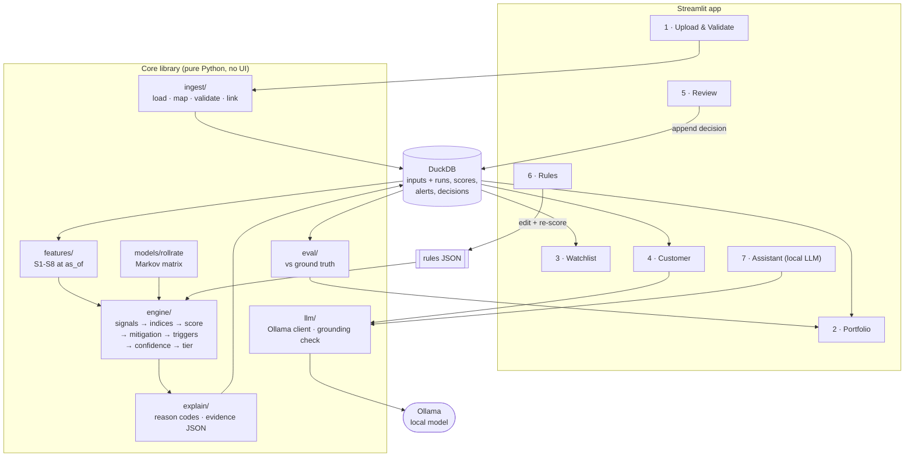

# Sentinel EWS: application architecture (review and recommendation)

Status: **proposal for team review.** Builds on Shaunak's `sentinel_mvp_architecture.png` and
`ews_final_features.txt`, checked against the data we generate (`docs/data_architecture.md`)
and the Level 1 requirements of problem statement 4.

## 1. What the challenge actually scores

Level 1 asks for five observable capabilities. The organiser runs hidden tests on the
application's behaviour, so each one must work through the UI, not just in a notebook.

| # | Required capability | Must be demonstrable as |
|---|---|---|
| 1 | Ingest CSV / Excel / JSON, validate, link records | Upload screen with an issues report |
| 2 | Detect 5 scenarios over time (repeated delays, temporary misses, declining cash flow, rising exposure, missing history) | Fired signals per customer, with the evidence values |
| 3 | Warning score with stated direction and explained contributions | Score, tier and per-factor breakdown |
| 4 | Watchlist with required columns and filters, drill-down | Filterable table → customer page |
| 5 | Analyst decision + reason, original score and evidence preserved | Review form + audit trail |

"Award points for observable behaviour, not architecture slides or unsupported AI claims."

## 2. Review of the Sentinel design

### Keep (strong and well suited)
- **Scenario modules with a composite index each** (RBDI, CFSI, LPI, roll risk, SME index, DCS).
  These map 1:1 to the challenge scenarios and to our data (see data doc §4).
- **Three outputs per customer:** tier, evidence confidence, trajectory. Separating *how risky*
  from *how sure we are* is exactly what scenario 7 asks for.
- **Plain-English reason codes on every feature.** This makes explainability come for free.
- **Exception engine with guardrails** (never mitigate repeated misses or underlying stress).
- **Seasonality adjustment for SMEs** (our data has a seasonal trap that needs it).
- **Hard triggers** that override the blended score.
- **"Silent stress" demo** (cash-flow stress while repayments are current).
- **Streamlit + a pure core library** (`score_customer`), with live recompute.

### Change

| # | Sentinel says | Problem | Recommendation |
|---|---|---|---|
| 1 | `norm(x)` = percentile rank or min-max **across the portfolio** | Scores become relative: a healthy portfolio still has a "worst 10%", and a customer's score changes when *other* customers change. Thresholds in the rules file lose meaning, and hidden tests with a different portfolio give unstable results. | **Absolute anchors per signal** from the rules file: value at `threshold` → strength 0.5, at `severe` → 1.0, linear in between, clipped. A score means the same thing for any portfolio and is easy to explain ("DSR 58% vs threshold 50%"). |
| 2 | ~50 hand-weighted features | Too many to tune or test in 3 hours; weights on unvalidated features look arbitrary. | Build the ~21 signals already in `rules/risk_signal_definitions.json`, grouped into the same modules. Module index = points earned / points available. Add features only when the eval shows a gap. |
| 3 | Missing values imputed from a peer-group baseline | Imputation invents evidence, which the challenge explicitly forbids for missing history. | Missing → signal **not evaluated** (shown as "no data"), points not awarded, **confidence lowered**. Never impute risk. |
| 4 | LightGBM as the primary predictor | 600 synthetic customers plus generator-made labels means the model mostly learns the generator. Judges discount "AI claims" they can't verify, and point-in-time labels don't exist yet. | Make the **roll-rate (Markov) matrix** the predictive core. It is estimated from ~19.5k real facility-month transitions in our data, is explainable, and directly answers scenario 5. Add LightGBM as an **optional second opinion** column (time-split, point-in-time labels) once the core works. |
| 5 | HDBSCAN behavioural clusters; minimum segment size 30 | Hard to explain, and a size of 30 suppresses the very clusters we planted (~14 customers in construction/north). | **Segment concentration test.** For every product × industry × emirate (and pairs), compare the at-risk rate with the portfolio rate (lift plus a Wilson/binomial interval), require ≥ 3 at-risk customers, and show momentum (rate now vs 3 months ago). |
| 6 | Diagram starts at "Parquet files" from the generator | No upload, validation, column mapping or audit store, so capabilities 1 and 5 are missing. | Add **ingest** (load → map → validate → link) and a **store** with frozen alerts and append-only decisions. |
| 7 | Priority = PD × LGD × EAD | We have no LGD data. | Sort by tier, then **exposure at risk** (outstanding × roll probability). |
| 8 | Features from row-level transactions (salary credit day, active days, payer HHI, GST turnover) | Not in our data (monthly aggregates only). | Drop for Level 1. Revisit if the organiser's sample has transactions. |
| 9 | ₹, Republic Day, RBI conventions | Our setting is UAE / AED. | Currency and holiday calendar come from data and rules, not code. |

## 3. Recommended architecture



### Scoring pipeline (deterministic order, so every step can be explained)

```
for each customer at as_of:
  1. signals      each rule → value, strength 0..1 (absolute anchors), or NOT_EVALUATED
  2. indices      RBDI, CFSI, LPI, Roll, SME = points earned / points available per module
  3. raw score    Σ weight × strength, capped 0..100        (higher = riskier)
  4. mitigation   S4: isolated + recovered + clean history (+ verified evidence)
                  → subtract points / max one tier down; blocked by guardrails
  5. triggers     DPD ≥ 90 → Red · DPD ≥ 60 or 2+ consecutive misses → ≥ Amber
  6. confidence   DCS (history length, coverage, bureau hit, completeness) → High/Med/Low
                  Low + no hard evidence → tier capped at Watch, label "insufficient evidence"
  7. tier         bands from rules file
  8. trajectory   same function at as_of − 3 months → Improving / Stable / Deteriorating
  9. evidence     JSON of every step (frozen into the alert)
```

Because `score_customer(as_of)` is a pure function of (data, rules, as_of), the same call
powers the watchlist, the rules-edit re-score, trajectory, and point-in-time training
labels if we add LightGBM later.

### Tiers (real-world convention)

Banks' early-warning frameworks typically use a red-amber-green (RAG) scale with a watch
level, kept separate from regulatory staging (IFRS 9) and DPD buckets:

| Tier | Score | Monitoring status | Typical action |
|---|---|---|---|
| Green | 0–24 | Normal | None |
| Watch | 25–44 | Watchlist | RM review, soft-touch contact |
| Amber | 45–69 | Action required | Contact customer, assess restructuring or limit freeze |
| Red | 70–100 or hard trigger | Escalate | Credit committee / collections, provisioning review |

Evidence confidence (High/Medium/Low) is shown as a badge next to the tier, never as a tier.

## 4. Local LLM: where it adds value without becoming an "unsupported AI claim"

Runtime: **Ollama** (already installed). This machine (M5 Pro, 24 GB) runs 7–8B models
comfortably. Candidates: `qwen3:8b` (strong instruction following and JSON output),
`llama3.1:8b`, and `llama3.2:3b` as a fast fallback. The app must work fully with the
LLM switched off.

| Use | Input | Output | Guardrail |
|---|---|---|---|
| Customer risk narrative | evidence JSON only | 4–6 sentence summary for the RM | Every number in the text must exist in the evidence (automatic check); otherwise fall back to template text |
| Recommended action draft | tier, signals, mitigation, policy snippets | Suggested next step + rationale | Labelled "suggestion"; the analyst decides |
| Review assistant | alert evidence + analyst's notes | Drafted decision reason | Analyst edits and submits; stored as the analyst's text |
| Portfolio briefing | cluster table | Short note on emerging segments | Numbers from the table only |
| Column-mapping helper (ingest) | unknown headers + sample rows | Proposed mapping to our schema | User confirms the mapping before load |

The LLM **never** computes or changes a score, tier or decision. It explains and drafts.
That keeps the core auditable and still demonstrates a working, low-cost AI product.

## 5. Repository layout

```
datagen/            synthetic data (done)
data/               sample, dirty, ground truth (done)
sentinel/
  ingest/           loaders.py · mapping.py · validate.py · link.py
  features/         repayment.py · cashflow.py · exposure.py · exceptions.py
                    rollrate.py · sme.py · completeness.py · clusters.py
  engine/           rules.py · scoring.py · explain.py
  store/            db.py (DuckDB), schema from sql/schema.sql
  llm/              ollama.py · prompts.py · grounding.py
  eval/             benchmark.py
app/                Streamlit: Home.py + pages/1_Upload … 7_Assistant
tests/              engine tests per archetype (fixtures from datagen)
```

## 6. Build order

1. **Ingest + store.** Load the sample from all 3 formats into DuckDB, with the validation report (dirty set). *Delivers capability 1.*
2. **Features S1, S2, S3, S4, S7 + engine + explain.** *Delivers capabilities 2–3.*
3. **Watchlist + customer page.** *Delivers capability 4.*
4. **Review + frozen alerts.** *Delivers capability 5. This is the Level 1 must-have line.*
5. Roll-rate matrix (S5), SME index (S6), clusters (S8), portfolio page, eval panel.
6. Rules editor with live re-score; trajectory.
7. Local LLM narrative + review assistant.
8. Optional: LightGBM second opinion, simulator.

## 7. Decision trade-offs (for team discussion)

| # | Decision | Recommended | Alternative | What we give up with the recommendation |
|---|---|---|---|---|
| 1 | Scoring scale | Absolute anchors per signal (from the rules file) | Portfolio percentile / min-max (Sentinel) | Needs sensible thresholds; percentiles need none and always spread customers across tiers. *Middle ground:* absolute score, plus percentile shown as context only. |
| 2 | Role of ML | Roll-rate Markov matrix as the predictive core; LightGBM optional later | LightGBM as primary predictor from the start, with SHAP drivers shown beside rule reasons | A weaker "AI" story. Making ML primary needs point-in-time labels from the 24 monthly snapshots (~1 extra hour) and risks learning the generator. |
| 3 | Engine shape | ~21 signals from the rules file, rolled up into Sentinel's index names (RBDI, CFSI, LPI…) | Sentinel's ~50 features and formula weights verbatim | Less granularity. The verbatim spec is closer to the design, but there are more parts to tune and test in 3 hours. |
| 4 | LLM scope | Explains and drafts (narrative, action draft, review reason, briefing, column mapping); never scores | **Larger:** analyst copilot answering portfolio questions over DuckDB (text-to-SQL). **Smaller:** customer narrative only. | The copilot is the most impressive demo but has the most failure modes; it needs SQL guardrails and read-only access. |
| 5 | Clusters (S8) | Segment concentration: lift vs portfolio + Wilson interval, ≥ 3 at-risk, momentum | HDBSCAN on behaviour features (Sentinel) | Only finds patterns along defined segments; HDBSCAN can find unplanned groupings but is harder to explain on screen. |
| 6 | Tiers | Green / Watch / Amber / Red + confidence badge | Low / Medium / High / Critical (challenge wording) | None functionally; RAG + Watch matches how bank EWS teams work. |
| 7 | Level 1 scope | Stop at build steps 1–4 (all mandatory capabilities), then extras | Build all 8 modules before polishing the UI | Extras land later; the mandatory line is safe early. |
| 8 | Stack | Streamlit + DuckDB + Ollama, one Python process | FastAPI backend + React UI | Less polished UI and no public API, but roughly half the build effort. |

## 8. Open points for the team
- Confirm whether the organiser's sample includes row-level transactions (affects S2/S6 features).
- Who owns which layer (suggestion: one person on ingest + UI, one on features + engine).
- Pick the local model after a quick latency test (`qwen3:8b` vs `llama3.2:3b`).
