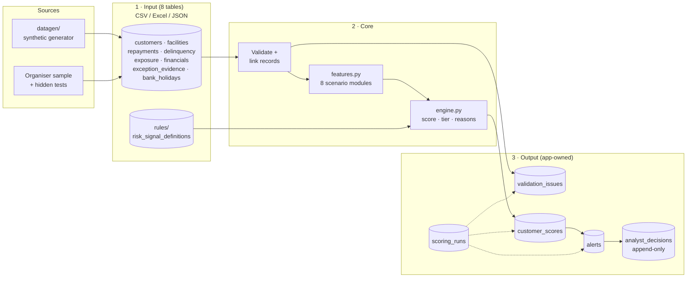
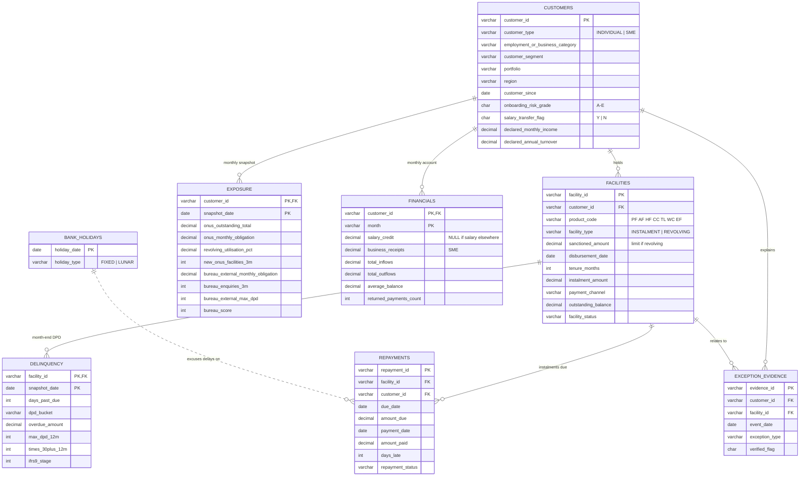
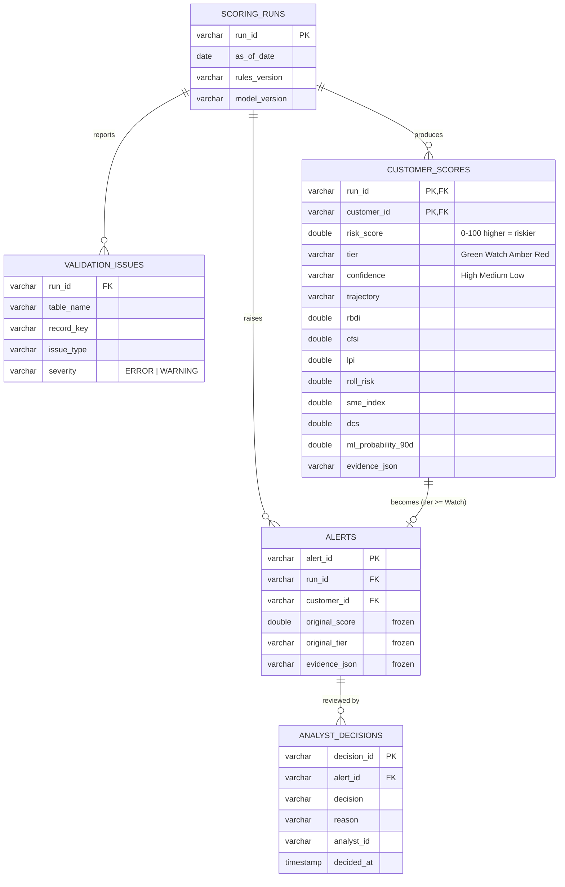

# Sentinel EWS: data architecture

How data enters, is stored, and leaves the Early Warning System. The physical model is in
[`sql/schema.sql`](../sql/schema.sql) (DuckDB). The column-level dictionary and generator
details are in [`data/README.md`](../data/README.md).

## 1. Layers

## 2. Input model (entity relationships)

**Grain:** `repayments` is per instalment, `delinquency` is per facility per month-end, and
`exposure` / `financials` are per customer per month. Everything joins on `customer_id`;
time joins use the month-end date (`snapshot_date` = `month_end_date`).

## 3. Output model (app-owned)

Required capability 5 says the original warning score and evidence must survive analyst
reclassification. So alerts are written once and never updated, and decisions are an
append-only log.

## 4. Source tables per scenario module

How the Sentinel feature spec (`ews_final_features.txt`) maps onto the tables.

| Module | Index | Primary tables | Key columns |
|---|---|---|---|
| S1 Repayment deterioration | RBDI | repayments, delinquency | days_late, repayment_status, amount_paid / amount_due, days_past_due |
| S2 Income & cash flow | CFSI | financials | salary_credit, total_inflows, average_balance, net_cash_flow |
| S3 Obligations & exposure | LPI | exposure, financials, customers | revolving_utilisation_pct, onus + bureau obligation, new_onus_facilities_3m, bureau_enquiries_3m |
| S4 Temporary exceptions | Mitigation | repayments, bank_holidays, exception_evidence, financials | due_date vs holiday, salary credit timing, verified_flag |
| S5 Roll-forward | Roll Risk | delinquency | dpd_bucket month-to-month transitions |
| S6 SME stress | SME Index | financials, exposure | business_receipts (YoY / deseasonalised), returned_payments_count, WC utilisation |
| S7 Missing history | DCS | all | months on book, missing months, bureau no-hit (bureau_* NULL) |
| S8 Clusters | Cluster Alert | customer_scores + customers | segment = product × industry × region × segment |

## 5. Gaps against the Sentinel minimum schema

| Sentinel expects | What we have | Proposal |
|---|---|---|
| `transactions` (row-level) | monthly aggregates in `financials` | Enough for Level 1. Features needing daily data (salary credit day, max gap, active days) are dropped or approximated. Raw transactions can be added to the generator later if wanted. |
| `enquiries` (dated) | `exposure.bureau_enquiries_3m` | Use the rolling count. |
| `sme_extra.gst_turnover`, `supplier_payments` | `declared_annual_turnover`, `total_outflows` | F6.7 compares declared turnover with receipts; F6.6 uses WC utilisation. GST returns could be added as a synthetic table. |
| `od_utilisation` | WC facility in `exposure.revolving_utilisation_pct` | Covered. |
| `labels.deteriorated_30/60/90` | `_ground_truth/customer_labels.csv` (as-of only) | For LightGBM training, derive point-in-time labels from the 24 monthly snapshots: features at month t, label = DPD ≥ 30 within t+1..t+3. |
| branch, channel, vintage | region, payment_channel, disbursement_date | Vintage derived from disbursement_date. |
| Parquet storage | CSV / Excel / JSON | Ingest any of the three formats, persist to DuckDB (or Parquet) inside the app. |
| Currency in ₹, Republic Day | INR, Indian holiday calendar | Matches; currency and holidays come from the `currency` rule parameter and the `bank_holidays` table, not code. |

## 6. Conventions

- **As-of date** comes from `rules.parameters.as_of_date` (2026-09-30), never `today()`.
- **Missing ≠ zero.** NULL means unknown; DQ signals lower confidence and never add risk.
- **Score direction:** 0–100, higher is riskier.
- **Grace and holidays:** `PAID_LATE` has no grace applied. The engine applies
  `grace_days` and excuses LUNAR holiday shifts.
- **IDs:** `CIF…` customers, `<product><7 digits>` facilities, `RP…` repayments, `EV…` evidence.
