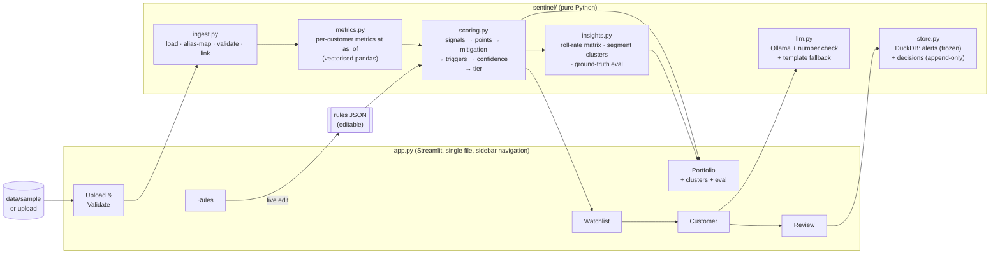

# Sentinel EWS: 1-hour prototype plan and trade-offs

Status: **built, 12:48–13:05 (see §8 for results and deviations).**
Goal: in 60 minutes, a working Streamlit app that demonstrates **all 5 Level 1 capabilities**
plus as many differentiators as fit. Every shortcut is listed in §5 so it can be revisited.
Parent design: `docs/app_architecture.md`.

## 1. Prototype architecture

**Two-stage compute (keeps rules edits instant):**
1. `metrics(data, as_of)`: heavy, cached. Runs once per dataset and date, plus once at `as_of − 3 months` for trajectory.
2. `score(metrics, rules)`: cheap, re-runs on every rules edit (≪1 s for 600 customers).

## 2. What gets built (timeboxed)

| Min | Block | Delivers |
|---|---|---|
| 0–5 | Deps (`streamlit`, `duckdb`, `altair`); rules file switched to Green/Watch/Amber/Red, `severe` anchors added | — |
| 5–15 | `ingest.py`: CSV / XLSX / JSON upload or bundled sample; header alias map; type coercion; ~15 validation checks (orphans, duplicates, bad dates, negatives, out-of-range, enum format, currency, status mismatch); error rows rejected, warnings kept; issues table | **Capability 1** |
| 15–30 | `metrics.py` + `scoring.py`: 18 risk signals + 3 data-quality flags from the rules file; absolute anchors; mitigation with guardrails; hard triggers; DCS confidence and cap; tier; trajectory; reasons; evidence JSON | **Capabilities 2, 3** |
| 30–38 | `insights.py`: roll-rate matrix by product group; segment concentration (lift, Wilson interval, ≥3 at-risk, momentum); ground-truth eval | S5, S8, accuracy proof |
| 38–42 | `store.py`, `llm.py` | Capability 5 backend, AI layer |
| 42–55 | `app.py`: 6 pages | **Capabilities 1–5 in the UI** |
| 55–60 | Smoke test in the built-in browser (clean + dirty data), eval numbers, commit | — |

### Signals in the prototype (from `rules/risk_signal_definitions.json`)

| Module | Signals | How the "temporary vs sustained" question is handled |
|---|---|---|
| S1/S5 Repayment (RBDI) | RS01 irregular months in last 6 · RS02 DPD rising month-ends · RS03 current DPD (bucket-scaled) · RS04 partials · RS06 recent cure | Counted per **month**, not per instalment (3 facilities ≠ 3× risk). Delays ≤ grace days or caused by a moon-sighting holiday are excused |
| S4 Exceptions | RS05 mitigant: exactly 1 irregular month in 12, ≥ 6 clean before, now current; stronger if evidence is verified | Guardrail: no mitigation if cash-flow or exposure modules are > 50% |
| S2/S6 Cash flow (CFSI) | RS07 inflow change (individual: last 3 vs prior 3 months; **SME: year-on-year**, which removes seasonality) · RS08 consecutive declines · RS09 salary stopped · RS10 balance erosion · RS11 returned payments | Salary signals are **not evaluated** when salary isn't credited to this bank |
| S3 Exposure (LPI) | RS12 utilisation · RS13 utilisation spike · RS14 debt burden (individuals) · RS15 new credit velocity · RS16 exposure outpacing income | — |
| Bureau | RS17 external DPD · RS18 score drop | Bureau no-hit → not evaluated |
| S7 Completeness (DCS) | DQ01 history < 6 months · DQ02 missing months · DQ03 bureau no-hit | Weight 0. Lowers confidence; Low confidence with no hard evidence → tier capped at Watch |

**Score:** Σ weight × strength, clipped to 0–100, higher = riskier. Strength = 0.5 at threshold, 1.0 at the
`severe` anchor. **Tiers:** Green < 25 ≤ Watch < 45 ≤ Amber < 70 ≤ Red.
**Hard triggers:** DPD ≥ 90 → Red; DPD ≥ 30 → at least Amber.
**Trajectory:** score now vs 3 months ago (±10 points), plus "Recovering" (was Amber or Red, now below).

### Pages

| Page | Contents |
|---|---|
| Upload & Validate | Source picker (sample clean / sample dirty / upload), row counts accepted vs rejected, issues table by severity, relationship summary |
| Portfolio | Tier mix, exposure at risk, emerging-cluster table (segment, n, at-risk rate, lift, momentum), roll-rate matrix, eval vs ground truth (confusion matrix, High/Critical catch rate, thin-file false-positive rate) |
| Watchlist | Customer ID, name, products, outstanding, score, tier, confidence, trajectory, top indicators, DPD bucket, monitoring status. Filters: product, segment, tier, DPD bucket, portfolio, region, category. Sorted by tier, then exposure × roll probability |
| Customer | Score breakdown (points per signal), fired signals with value vs threshold and reason, mitigation note, module indices, roll probability; charts: DPD, inflows, balance, utilisation; repayments, facilities, evidence; **AI summary** button |
| Review | Alert queue (Watch+), frozen original score/tier/evidence, decision (4 options) + mandatory reason + analyst name, full decision history; reclassifying never alters the frozen alert |
| Rules | Editable signal table (enabled, threshold, severe, weight) and bands → instant re-score with before/after tier counts; download JSON |

## 3. Local LLM (prototype scope)
- One feature: **customer risk summary** on the Customer page, generated by Ollama from the evidence JSON only.
- **Number check:** every number in the output must appear in the evidence; if one doesn't, the app shows the template summary with a warning.
- **Ollama not running or no model pulled:** the button shows the deterministic template summary instead. The app never blocks.
- No model download happens in the build. You run `ollama pull qwen3:8b` (≈5 GB) or `llama3.2:3b` (≈2 GB) when you want it on.

## 4. Explicitly NOT in the 1-hour prototype
- LightGBM / any trained ML model (roll-rate matrix is the predictive element)
- Review assistant, portfolio briefing and column-mapping via LLM (template or manual only)
- What-if simulator
- Interactive column-mapping UI (alias map only)
- Authentication / user roles (analyst name is free text)
- Automated test suite (smoke test + ground-truth eval only)
- Multi-run history beyond "publish alerts" snapshots

## 5. Trade-offs taken for speed

| # | Shortcut | Why acceptable now | Risk | Fix later |
|---|---|---|---|---|
| 1 | Single `app.py` with sidebar navigation instead of a multipage package | Fastest to build and debug | File grows large, merge conflicts | Split into `app/pages/` |
| 2 | pandas in memory for inputs; DuckDB only for alerts/decisions | 600 customers fit easily; avoids an ORM layer | Won't scale to millions of rows | Push metrics into DuckDB SQL |
| 3 | Header alias map instead of a mapping UI | Covers common header variants | Unusual organiser headers fail validation | Mapping screen + LLM suggestion |
| 4 | Point-in-time for past dates is approximate (repayment status as of today, filtered by payment date ≤ as_of) | Good enough for trajectory | Partial-payment history before as_of not reconstructable | Store payment events, not settled status |
| 5 | Severe anchors default to 2× threshold where not set | Avoids tuning 21 pairs by hand | Some strengths miscalibrated | Tune on ground-truth eval |
| 6 | Debt burden not evaluated for SMEs | Salary-based ratio is meaningless for businesses | SME over-leverage caught only via utilisation and new credit | Add debt-service coverage from receipts |
| 7 | Clusters on category × region and product × region only | Matches the planted clusters and is explainable | Misses other combinations | Generic segment search |
| 8 | Roll probability is the empirical rate per bucket × product group, not adjusted per customer | Transparent; real transition data | Same probability for all customers in a bucket | Logistic adjustment with RBDI/CFSI |
| 9 | Template text is the default summary; LLM is opt-in | No runtime dependency during judging | LLM feature invisible if Ollama is off | Pre-pull the model before the demo |
| 10 | Weights from the rules file, untuned | Configurable by design | Some tiers off vs ground truth | Iterate with the eval panel |
| 11 | No unit tests; smoke test + eval only | Time | Regressions on later changes | `tests/` per archetype |

## 6. Done criteria at minute 60
- App starts with `uv run streamlit run app.py` and loads the sample in < 10 s.
- The dirty set shows validation issues, with error rows rejected.
- The watchlist filters work; the customer page explains the score.
- A decision can be recorded and reclassified, and the original alert stays unchanged.
- Editing a rule threshold changes tiers live.
- Eval panel shows catch rate on planted High/Critical and false positives on thin-file customers.
- Committed and pushed to `haren-dev`.

## 7. If the clock runs short (cut order)
1. LLM button (template summary remains)
2. Rules editor (rules still loaded from file)
3. Roll-rate matrix and clusters
4. Eval panel

The 5 Level 1 capabilities are never cut.

## 8. Build results

All done criteria (§6) met and verified in the browser, except the local LLM, which runs in
template mode until a model is pulled.

| Check | Result |
|---|---|
| Ingest: clean sample in CSV, JSON and Excel | 67,897 records, 0 issues in each format |
| Ingest: dirty sample | 516 rows rejected (errors), 42 warnings, all 15 injected defect types detected |
| Metrics + scoring time (600 customers) | 0.4 s metrics, 0.5 s scoring; rules edits re-score live |
| Planted High/Critical customers flagged Amber or Red | **75.8%** |
| Low-risk customers flagged Amber or Red (false alarms) | **0.0%** |
| Trap customers flagged (isolated exception, seasonal SME, thin file, salary elsewhere, cured) | **0 / 130** |
| Predicted tier within one tier of planted band | 97.5% |
| Planted cluster found | Construction & Contracting · Pune: 50% at risk vs 15.5% portfolio, lift 3.2 |
| Review | 130 alerts frozen; decision then reclassification recorded; original Red/100 unchanged |
| Rules editor | Disabling one signal moved 11 customers to Green; rules version tag changes |

### Deviations from the plan
- **Signal weights tuned once** against the eval panel (RS01 30, RS07 20, RS12 12, RS14 15,
  RS15 12, RS10/RS13/RS16 10; RS01 severe 3). Catch rate went from 54% to 76% with no new
  false alarms.
- **Hard trigger lowered** from DPD ≥ 60 to DPD ≥ 30 → at least Amber (matches Sentinel spec).
- **Repayment signals count months, not instalments**, so customers with several facilities
  aren't over-penalised.
- **Streamlit navigation** from the watchlist uses a button callback (widget state can't be
  set after render).

### Known gaps found during verification
- About 24% of planted High/Critical customers are missed. Roughly half have **no observable
  signal yet** (the generator planted a late onset that never produced a missed payment
  before the as-of date). The engine is right to leave them Green; the ground-truth label is
  optimistic. The other half are pay-cut income declines, where only one moderate signal fires.
- Hospitality-in-Bengaluru cluster is not flagged as emerging: its customers mostly reach Watch,
  and the cluster test counts Amber/Red only.
- LLM summary path is implemented and grounded but **not exercised** (no model pulled).
